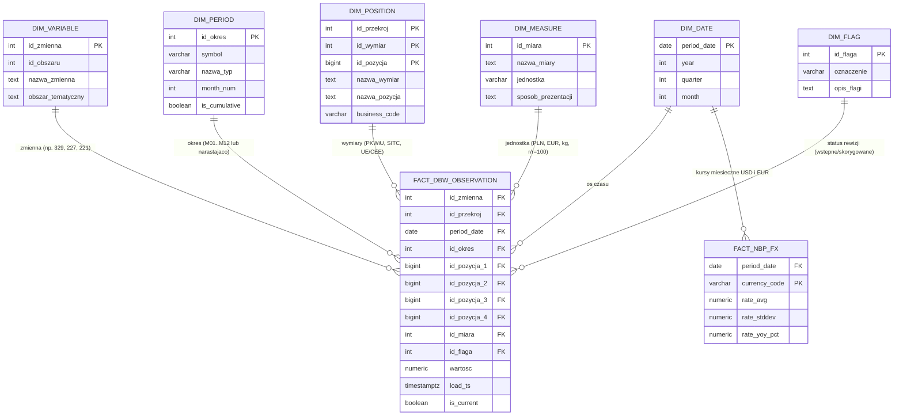
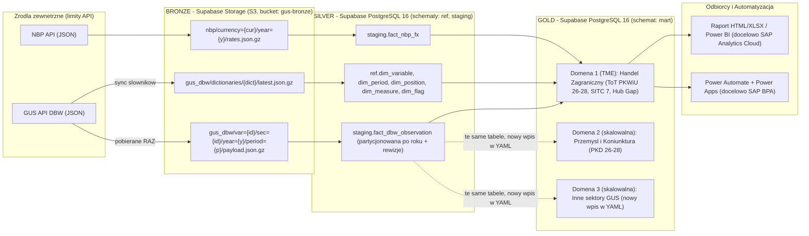

# Model danych (Star Schema) i architektura chmurowa (Supabase Free Tier)

Ten dokument opisuje, jak ułożone są dane z **API DBW GUS** oraz **API NBP** w uniwersalnym modelu gwiazdy oraz jak działają w chmurze na bazie **Supabase Free Tier** (chmurowy **PostgreSQL 16** + **S3-compatible Storage** w jednym darmowym projekcie).

---

## 1. Graf modelu danych (Model Gwiazdy – Star Schema)

W API DBW GUS główna tabela z danymi liczbowymi (`FACT_DBW_OBSERVATION`) nie zawiera nazw tekstowych — przechowuje wyłącznie klucze obce (`id_*`), które łączą się ze słownikami wymiarów (`DIM_*`). Ten sam schemat obsługuje **wszystkie** zmienne i sektory w GUS DBW (handel zagraniczny, przemysł, budownictwo, energetykę, B+R) bez dodawania nowych tabel faktów.

---

## 2. Architektura chmurowa Medallion na Supabase (Bronze → Silver → Gold)

Dane przepływają przez 3 warstwy w jednym projekcie **Supabase**:

### Jak ta architektura chroni przed limitami i zapewnia skalowalność?
1. **Brak marnowania limitów API GUS:** Ekstraktor przed wywołaniem GUS sprawdza, czy dany plik istnieje już w buckecie `gus-bronze` w **Supabase Storage**. Historyczne lata (`2019–2024`) pobierane są **dokładnie raz**. Przy cyklicznym odświeżaniu pobierany jest tylko najnowszy miesiąc oraz ostatnie 3 miesiące (z uwagi na rewizje danych wstępnych Intrastat, `id_flaga = 31 → 32`).
2. **Skalowalność na inne sektory GUS:** Dodanie nowego obszaru (np. *Koniunktury PKD 26/27/28*, *Budownictwa* czy *B+R*) polega wyłącznie na dopisaniu nowego bloku w [trade_series_config.yml](../config/trade_series_config.yml) i utworzeniu widoku biznesowego w schemacie `mart`. Warstwy **Bronze** (Supabase Storage) i **Silver** (`ref.*`, `staging.*`) działają bez żadnych zmian w schemacie.

---

## 3. Uzasadnienie wyboru technologii i mapowanie na środowisko TME (SAP)

- **Dlaczego Supabase Free Tier (PostgreSQL 16 + S3 Storage)?**
  - **Koszt 0 zł i brak karty kredytowej:** jedno darmowe konto daje **500 MB** zarządzanego **PostgreSQL 16** (cała historia 2019–2026 zajmuje <15 MB) oraz **1 GB** obiektowego **Storage zgodnego z S3** na warstwę Bronze.
  - **Łatwa prezentacja i audyt:** wbudowany panel webowy (*Storage Browser*, *Table Editor*, *SQL Editor*) pozwala na żywo pokazać surowe pliki z GUS, strukturę gwiazdy i wyniki zapytań SQL z dowolnego komputera.
  - **Brak vendor lock-in:** cały kod korzysta wyłącznie ze standardowych protokołów (**PostgreSQL / SQLAlchemy** oraz **S3 / boto3**).

- **Mapowanie na docelowy stack produkcyjny w TME:**

| Warstwa w projekcie (MVP) | Docelowy odpowiednik w środowisku TME |
|---|---|
| **Supabase Storage (S3)** – warstwa `Bronze` | **Azure Data Lake Storage Gen2 / Azure Blob** |
| **Supabase PostgreSQL 16** – warstwy `Silver` (`ref`, `staging`) i `Gold` (`mart`) | **SAP HANA / SAP Datasphere** |
| **Raport HTML/XLSX / Power BI** | **SAP Analytics Cloud (SAC)** + **Analysis for Office** |
| **Apache Airflow** | **Apache Airflow** |
| **Microsoft Power Automate + Power Apps** | **Power Automate**, **Power Apps** oraz **SAP Build Process Automation** |

---

## 4. Konfiguracja Supabase (2 minuty)

1. Utwórz darmowy projekt na https://supabase.com/ (region np. *Central EU – Frankfurt*).
2. W **Project Settings → Database → Connection string** skopiuj adres PostgreSQL (URI, tryb *Session pooler* lub *Direct*) i wklej jako `DATABASE_URL` w pliku `.env`.
3. W **Storage → New bucket** utwórz prywatny bucket o nazwie **`gus-bronze`**.
4. W **Project Settings → Storage → S3 Access Keys** wygeneruj parę kluczy (`Access Key ID` i `Secret Access Key`) oraz skopiuj `Endpoint` i `Region` do `.env`.
