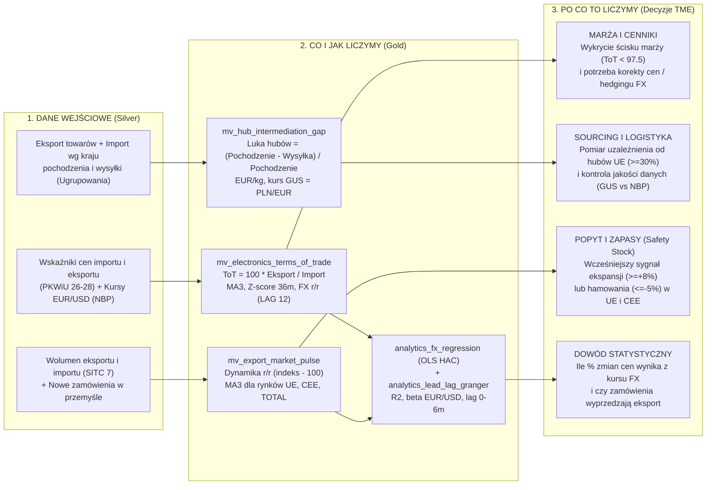

# Warstwa Gold (`mart.*`) i logika obliczeń (Silver → Gold)

Dokument opisuje przejście **Silver → Gold**: co dokładnie jest liczone w bazie (SQL) oraz w modułach statystycznych (Python), w jaki sposób powstają wskaźniki i gdzie trafiają dalej.

---

## 1. Mapa przepływu: Dane → Co i jak liczymy → Po co (TME)

---

## 2. Jak działa przejście Silver → Gold?

Przeliczenie warstwy Gold odbywa się w **dwóch etapach**:
1. **Warstwa SQL (`src/pipelines/build_marts.py`):** tworzy i odświeża bez blokowania odczytów (`REFRESH MATERIALIZED VIEW CONCURRENTLY`) 3 widoki zmaterializowane.
   - Każde zapytanie filtruje wyłącznie aktualne rekordy (`is_current = true`), łączy się ze słownikami `ref.*` po `business_code` (zero gołych ID GUS) oraz obraca tabelę z formatu długiego na szeroki (*pivot* przez `MAX(CASE WHEN ... END)`).
2. **Warstwa statystyczna Python (`src/analytics/models_fx_granger.py`):** czyta gotowe widoki z kroku 1, szacuje modele ekonometryczne i zapisuje wyniki (`UPSERT`) do 2 tabel w schemacie `mart`.

---

## 3. Widoki zmaterializowane w SQL (`mart.mv_*`)

### 3.1. `mart.mv_electronics_terms_of_trade`
- **Plik SQL:** [sql/02_mart_electronics_tot.sql](../sql/02_mart_electronics_tot.sql)
- **Wejście (Silver):** *Wskaźniki cen importu i eksportu wg PKWiU* (`PRICE_IMP_EXP_PKWIU`) + *Kursy średnie walut NBP* (`EUR`, `USD`).
- **Co i jak jest liczone:**
  - `eur_pln_yoy_pct`, `usd_pln_yoy_pct` — dynamika kursów NBP r/r przez funkcję okna `LAG(..., 12)`.
  - `implied_tot_yoy` = `100 × exp_price_yoy_idx / imp_price_yoy_idx` (sektorowe *Terms of Trade*).
  - `price_spread_pp` = `exp_price_yoy_idx - imp_price_yoy_idx` (różnica dynamiki cen eksportu i importu w pkt proc.).
  - `tot_ma3` — 3-miesięczna średnia krocząca (`AVG OVER ROWS BETWEEN 2 PRECEDING AND CURRENT ROW`).
  - `tot_z36` — standaryzowany *Z-score* z 36 miesięcy (`(ToT - AVG_36m) / STDDEV_36m`).
  - `pricing_status` — klasyfikacja `CASE`: `< 97.5` → `MARGIN_SQUEEZE_ALERT`, `> 102.0` → `MARGIN_TAILWIND`, pozostałe → `NEUTRAL`.
- **Gdzie trafia:** `models_fx_granger.py`, raport HTML, alerty Power Automate, Power BI.

### 3.2. `mart.mv_hub_intermediation_gap`
- **Plik SQL:** [sql/03_mart_hub_intermediation_gap.sql](../sql/03_mart_hub_intermediation_gap.sql)
- **Wejście (Silver):** *Eksport towarów wg ugrupowań* (`EXPORT_GROUPS`) + *Import towarów wg kraju pochodzenia* (`IMPORT_ORIGIN_GROUPS`) + *Import towarów wg kraju wysyłki* (`IMPORT_CONSIGNMENT_GROUPS`).
- **Co i jak jest liczone:**
  - `hub_reexport_balance_eur` = `imp_consign_eur - imp_origin_eur`.
  - `share_gap_pp` = `imp_consign_share_pct - imp_origin_share_pct`.
  - `indirect_hub_share_pct` = `100 × (imp_origin_eur - imp_consign_eur) / imp_origin_eur` (udział pośrednictwa hubów europejskich dla towarów pochodzących z danego regionu, np. Azji/LatAm).
  - `export_yoy_pln_pct` = `export_yoy_pln_idx - 100`.
  - `export_eur_per_kg` = `export_eur / export_mass_kg` (gęstość wartościowa eksportu).
  - `implied_eur_pln_rate` = `export_pln / export_eur` (implikowany kurs przeliczeniowy GUS).
- **Gdzie trafia:** testy jakości `data_quality/dq_checks.sql` (walidacja kursu GUS vs NBP), alerty Power Automate (`>= 30%` pośrednictwa hubów UE), Power BI.

### 3.3. `mart.mv_export_market_pulse`
- **Plik SQL:** [sql/04_mart_export_market_pulse.sql](../sql/04_mart_export_market_pulse.sql)
- **Wejście (Silver):** *Wskaźnik wolumenu eksportu SITC 7* (`VOL_EXP_SITC7`) + *Wskaźnik wolumenu importu SITC 7* (`VOL_IMP_SITC7`) + *Nowe zamówienia w przemyśle* (`NEW_ORDERS_FOREIGN`).
- **Co i jak jest liczone:**
  - Przeliczenie indeksów `= 100` na procenty (`wartosc - 100`) dla wolumenów eksportu/importu SITC 7 (`UE`, `CEE`, `TOTAL`) oraz nowych zamówień niekrajowych i ogółem.
  - `sitc7_export_vol_ma3_pct` oraz `ind_foreign_orders_ma3_pct` — 3-miesięczne średnie kroczące (`AVG OVER`).
  - `market_momentum_status` — klasyfikacja `CASE`: `>= 8.0%` → `STRONG_EXPANSION`, `>= 2.0%` → `GROWTH`, `<= -5.0%` → `CONTRACTION`, pozostałe → `STAGNATION`.
- **Gdzie trafia:** `models_fx_granger.py`, raport HTML, alerty Power Automate, Power BI.

---

## 4. Tabele statystyczne liczone w Pythonie (`mart.analytics_*`)

- **Plik:** [src/analytics/models_fx_granger.py](../src/analytics/models_fx_granger.py) (DDL: [sql/05_mart_analytics_tables.sql](../sql/05_mart_analytics_tables.sql))

| Tabela Gold | Zakres | Metoda obliczeniowa (`statsmodels` / `scipy`) | Gdzie trafia |
|---|---|---|---|
| **`mart.analytics_fx_regression`** | `12` wierszy (4 sektory PKWiU × 3 cele) | Regresja wieloraka **OLS z odpornymi błędami standardowymi Newey-West (HAC)**: `cel ~ stała + EUR/PLN r/r + USD/PLN r/r`. Zapisuje `R²`, `Adj R²`, `β_EUR`, `β_USD` i `p-value`. | Raport HTML, Power BI |
| **`mart.analytics_lead_lag_granger`** | `49` wierszy (7 par × opóźnienia `0..6` mies.) | Korelacja Pearsona (`r`, `p-value`) dla `lag = 0..6m` oraz test przyczynowości **Grangera** (`F-stat`, `p-value`) dla `lag = 1..6m` (pary: kursy FX → PKWiU 26 oraz zamówienia zagraniczne → wolumen SITC 7). | Power BI |

