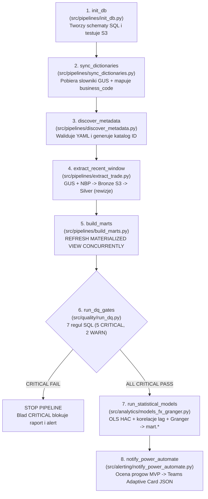

# Przepływ wykonania w kodzie (Pipeline End-to-End)

Dokument pokazuje **kolejność uruchamiania kodu** od pobrania danych z API aż po wygenerowanie raportu i wysłanie alertu, podział odpowiedzialności między moduły w `src/` oraz mechanizmy odporności na błędy.

---

## 1. Schemat przepływu DAG-a produkcyjnego (`tme_gus_export_sourcing_monthly`)

Uruchamiany automatycznie **22. dnia każdego miesiąca o 06:00 UTC** (po publikacji miesięcznego biuletynu GUS):

*(Osobny DAG [tme_gus_backfill_chunked.py](../dags/tme_gus_backfill_chunked.py) jest domyślnie zapauzowany i służy wyłącznie do bezpiecznego, paczkowanego dogrywania wieloletniej historii `2019–2026` co 20 minut z poszanowaniem limitów API GUS.)*

---

## 2. Co dokładnie dzieje się w każdym z 8 kroków?

| Krok | Moduł Pythona | Co robi pod spodem | Zapisuje / aktualizuje |
|---:|---|---|---|
| **1** | [init_db.py](../src/pipelines/init_db.py) | Wykonuje skrypty `sql/00_*` i `sql/01_*` (idempotentnie `IF NOT EXISTS`) oraz sprawdza dostęp do bucketa S3 `gus-bronze`. | Schematy `ref`, `staging`, `mart` + partycje `2019–2026` |
| **2** | [sync_dictionaries.py](../src/pipelines/sync_dictionaries.py) | Pobiera słowniki okresów, miar, flag i pozycji z API DBW GUS, filtruje wyłącznie okresy miesięczne/narastające i dopisuje `business_code` z `config/trade_series_config.yml`. | `ref.dim_*` + backup słowników w Bronze S3 |
| **3** | [discover_metadata.py](../src/pipelines/discover_metadata.py) | Sprawdza, czy każde ID w pliku YAML istnieje w słownikach `ref.*` i generuje audytowalny katalog metadanych. | [docs/gus_metadata_catalog.md](gus_metadata_catalog.md) |
| **4** | [extract_trade.py](../src/pipelines/extract_trade.py) | Dla każdego zbioru i miesiąca sprawdza cache w Bronze S3; pobiera z GUS tylko brakujące lub ostatnie 3 miesiące (`recheck_recent_months: 3`). Dla NBP dociąga też rok bazowy (`min(years) - 1`). | Pliki `.json.gz` w S3 + `staging.fact_dbw_observation`, `staging.etl_revision_audit`, `staging.fact_nbp_fx` |
| **5** | [build_marts.py](../src/pipelines/build_marts.py) | Buduje (jeśli nie istnieją) i odświeża bez blokowania odczytów 3 widoki zmaterializowane (`sql/02..04`) oraz widok kalendarza `mart.dim_date` (`sql/06`). | `mart.mv_*` + `mart.dim_date` |
| **6** | [run_dq.py](../src/quality/run_dq.py) | Uruchamia 7 reguł SQL z [dq_checks.sql](../data_quality/dq_checks.sql). Jeśli jakakolwiek reguła `CRITICAL` zwróci `failed_rows > 0`, przerywa DAG wyjątkiem `RuntimeError`. | Raport DQ w logach (bramka *Pass/Fail*) |
| **7** | [models_fx_granger.py](../src/analytics/models_fx_granger.py) | Czyta widoki Gold, liczy regresję OLS (Newey-West HAC), korelacje z opóźnieniem `0–6m` i test Grangera (`1–6m`). | `mart.analytics_fx_regression`, `mart.analytics_lead_lag_granger` |
| **8** | [notify_power_automate.py](../src/alerting/notify_power_automate.py) | Czyta najnowsze statusy z `mart.*`, ocenia krytyczne progi MVP i wysyła JSON z kartą **Teams Adaptive Card v1.4** na `PA_WEBHOOK_URL` (lub zapisuje lokalnie w trybie dry-run). | `reports/last_power_automate_payload.json` (+ HTTP POST do Power Automate) |

---

## 3. Podział kodu na pakiety w `src/`

Kod jest podzielony na **6 niezależnych pakietów** (separacja odpowiedzialności):

- **`src/core/`** — fundamenty współdzielone przez cały projekt: konfiguracja z `.env` i YAML (`settings.py`), połączenia PostgreSQL (`db.py`), klient S3 Bronze z kompresją `.json.gz` (`storage_s3.py`).
- **`src/clients/`** — komunikacja z zewnętrznymi API: klient GUS DBW z paginacją, throttlingiem i retry (`dbw_client.py`) oraz klient NBP z agregacją dzienną → miesięczną (`nbp_client.py`).
- **`src/pipelines/`** — kroki ETL (`init_db`, `sync_dictionaries`, `discover_metadata`, `extract_trade`, `build_marts`).
- **`src/quality/`** — runner reguł jakości danych SQL (`run_dq.py`).
- **`src/analytics/`** — ekonometria (`models_fx_granger.py`) i wizualizacja HTML (`generate_report.py`).
- **`src/alerting/`** — reguły biznesowe i wysyłka alertów (`notify_power_automate.py`).

---

## 4. Kluczowe mechanizmy odporności w kodzie

1. **Ochrona przed limitami API GUS (`HTTP 429`) i wznawianie:**
   - `DBWClient` stosuje automatyczny *throttling* i ponowienia *exponential backoff* (`tenacity`).
   - Przed każdym zapytaniem do GUS `extract_trade.py` sprawdza, czy plik istnieje w **Bronze S3** — historyczne miesiące zużywają **0 zapytań API**.
   - Transakcja w bazie jest zatwierdzana (`conn.commit()`) **po każdym miesiącu**. Jeśli GUS zwróci `429`, skrypt kończy pętlę bez utraty danych, a kolejne uruchomienie wznawia dokładnie od przerwanego miejsca.
2. **Obsługa rewizji Intrastat (SCD Type 2 + Audyt):**
   - Ostatnie 3 miesiące są sprawdzane ponownie. Gdy GUS zmieni wartość historyczną, stary rekord dostaje `is_current = false`, nowy wchodzi z `is_current = true`, a stara/nowa wartość i `%` różnicy są logowane w `staging.etl_revision_audit`.
3. **Bramka Jakości Danych (Data Quality Gates):**
   - Pipeline nigdy nie wygeneruje raportu ani alertu na uszkodzonych danych — 5 reguł `CRITICAL` w [dq_checks.sql](../data_quality/dq_checks.sql) (brak duplikatów `is_current`, kompletność `business_code`, pary import/eksport PKWiU, dodatnie obroty/masy, poprawny zakres kursów NBP) zatrzymuje DAG przed krokami 7–9.
4. **Izolacja środowisk (Docker) i testy automatyczne (`pytest`):**
   - Osobne obrazy dla workerów ETL (`Dockerfile`, Python 3.12) i orkiestratora (`Dockerfile.airflow`, Airflow 2.10.4 z oficjalnymi *constraints* i *lazy imports* w DAG-ach dla szybkiego parsowania).
   - Zestaw 10 testów w `tests/` weryfikuje parsery okresów GUS, agregację NBP, spójność YAML, budowanie kart alertowych oraz na żywo stan warstwy Gold i bramki DQ w Supabase.

