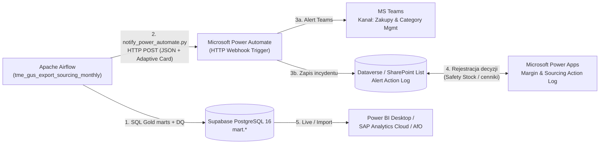

# Mapowanie rozwiązania na ekosystem Microsoft Power Platform i SAP (TME)

Dokument opisuje, jak działający potok **TME Export & Sourcing Pulse** (Python + Supabase PostgreSQL 16/S3 + Apache Airflow) integruje się z narzędziami wykorzystywanymi w środowisku korporacyjnym **Transfer Multisort Elektronik (TME)**: **Power Automate, Power Apps, Power BI** oraz ekosystemem **SAP (SAP Datasphere / HANA Cloud, SAP Analytics Cloud, Analysis for Office, SAP Build Process Automation)**.

---

## 1. Architektura End-to-End (Alerting i Workflow decyzyjny)

---

## 2. Integracja z Microsoft Power Automate

Moduł [notify_power_automate.py](file:///d:/repos/rekrutacja/tme-gus-export-sourcing-pulse/src/alerting/notify_power_automate.py) na końcu miesięcznego DAG-a odczytuje najnowsze statusy z widoków `mart.*` oraz licznik rewizji z `staging.etl_revision_audit`, ocenia reguły alarmowe i wysyła ustrukturyzowany JSON na adres `PA_WEBHOOK_URL` (lub zapisuje go lokalnie do `reports/last_power_automate_payload.json` w trybie `--dry-run`).

### Reguły wyzwalania alertów (MVP – wyłącznie sygnały krytyczne)
| Kategoria | Źródło (Gold) | Warunek alarmowy | Rekomendowana akcja TME |
|---|---|---|---|
| **Presja marżowa** | `mart.mv_electronics_terms_of_trade` | `pricing_status = 'MARGIN_SQUEEZE_ALERT'` (`implied_tot_yoy < 97.5`) | Przegląd cenników eksportowych i polityki zabezpieczeń EUR/USD |
| **Hamowanie popytu** | `mart.mv_export_market_pulse` | `market_momentum_status = 'CONTRACTION'` (`sitc7_export_vol_yoy_pct <= -5.0%`) | Redukcja ryzyka *overstock* w indeksach wolnorotujących (grupa C) |

### Konfiguracja przepływu w Power Automate (Cloud Flow)
1. **Trigger:** `When a HTTP request is received` (metoda `POST`, wygenerowany URL wklejamy jako `PA_WEBHOOK_URL` w `.env`).
2. **Condition:** Sprawdzenie `triggerBody()?['has_alerts']` (`true` = `ALERT`, `false` = `OK`).
3. **Action 1 (MS Teams):** `Post card in a chat or channel` — w treści wstawiamy bezpośrednio gotowy obiekt `triggerBody()?['teams_adaptive_card']` (Adaptive Card v1.4 z tabelą KPI i listą rekomendacji).
4. **Action 2 (Audyt decyzji):** Dla `has_alerts = true` przepływ tworzy rekord w tabeli **Dataverse / SharePoint List** (`Alert Action Log`) z przypisanym Category Managerem i terminem reakcji (+5 dni roboczych).

---

## 3. Aplikacja biznesowa Microsoft Power Apps (*Margin & Sourcing Action Log*)

Aby alerty nie kończyły się wyłącznie na wiadomości na czacie, uzupełnieniem przepływu jest lekka aplikacja Canvas w **Power Apps** dla Category Managerów i Działu Zakupów:
- **Ekran 1 (Lista aktywnych sygnałów):** Lista alertów z Dataverse/SharePoint odfiltrowana po statusie (`Open` / `In Review` / `Closed`) oraz sektorze (`PKWiU 26`, `PKWiU 27`, `PKWiU 28`, rynki `UE`/`CEE`).
- **Ekran 2 (Formularz decyzji):** Category Manager rejestruje konkretną akcję biznesową:
  - typ decyzji (`Korekta marży / cennika`, `Zmiana Safety Stock`, `Renegocjacja z dostawcą`, `Brak akcji – czynnik jednorazowy`),
  - przypisane grupy indeksów TME,
  - komentarz i datę weryfikacji efektu.
- **Zamknięcie pętli (Feedback Loop):** Decyzje z Power Apps wracają do hurtowni danych, co pozwala po kwartale mierzyć skuteczność reakcji zakupowych względem sygnałów makro GUS.

---

## 4. Mapowanie na ekosystem SAP (produkcyjne wdrożenie w TME)

Zaprojektowana architektura **Medallion (Bronze → Silver → Gold)** nie jest przywiązana do jednego dostawcy chmury — każdy komponent mapuje się bezpośrednio 1:1 na docelowy stack SAP:

| Warstwa / Funkcja | Implementacja w prototypie (Open-Source / Free Tier) | Odpowiednik produkcyjny w ekosystemie SAP (TME) |
|---|---|---|
| **Bronze (Raw Landing)** | Supabase Storage S3 (`gus-bronze/*.json.gz`) | **SAP Datasphere Object Store** / Azure Data Lake Storage Gen2 |
| **Silver (Star Schema + rewizje)** | Supabase PostgreSQL 16 (`ref.*`, `staging.*`, partycje roczne) | **SAP HANA Cloud / SAP Datasphere** (tabele partycjonowane + wersjonowanie delta) |
| **Gold (Warstwa semantyczna)** | Zmaterializowane widoki `mart.*` + tabele statystyczne (`mart.analytics_*`) | **SAP Datasphere Analytic Models** / Calculation Views w SAP HANA |
| **Orkiestracja ETL i DQ** | Apache Airflow (`tme_gus_export_sourcing_monthly`) + `dq_checks.sql` | **SAP Datasphere Task Chains** / **SAP Data Intelligence** (lub utrzymanie Airflow jako orkiestratora zewnętrznych API) |
| **Raportowanie zarządcze** | Power BI Desktop (bezpośrednie połączenie PostgreSQL) + raport HTML Plotly | **SAP Analytics Cloud (SAC)** (Live Connection do Datasphere) |
| **Analizy ad-hoc dla kontrolingu** | Eksport / zapytania SQL z `mart.*` | **SAP Analysis for Microsoft Office (AfO)** podłączone do modeli SAP Datasphere |
| **Automatyzacja procesów ERP** | `notify_power_automate.py` → MS Power Automate → Teams | **SAP Build Process Automation (SBPA)** — np. automatyczne otwieranie workflow przeglądu cen/buforów w SAP S/4HANA |

